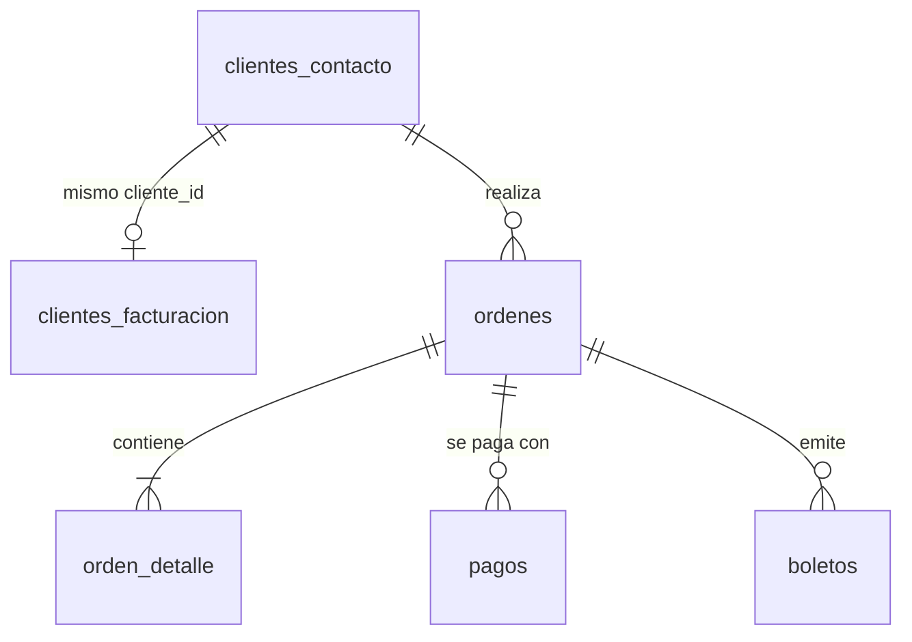
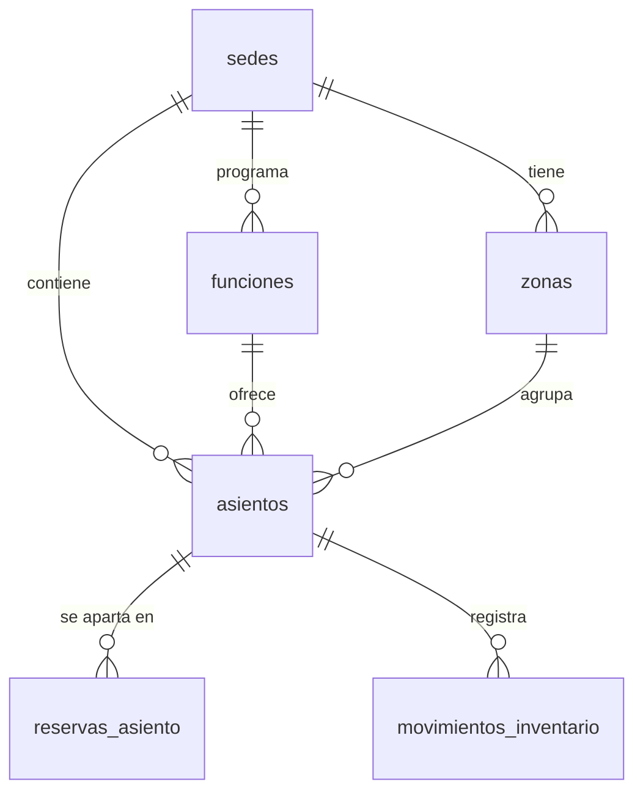

# Arquitectura de Boletera

Proyecto Final de Ingeniería de Datos (UAA 2026).

Plataforma de venta de boletos para eventos que usa MySQL, PostgreSQL y MongoDB de forma integrada sobre tres computadoras físicas conectadas por red local. Las bases no se comunican entre sí: la API es la única que las coordina.

## 1. Distribución de servicios

Las IPs son de ejemplo hasta confirmar las reales (ver `inventario.md`).

| PC | Servicios |
|---|---|
| PC1 | MySQL nodo 1, Mongo config 1, Mongo shardA nodo 1, Mongo shardB nodo 1, mongos (segundo), Prometheus, Grafana, API, exporters |
| PC2 | PostgreSQL primario, MySQL nodo 2, Mongo config 2, Mongo shardA nodo 2, Mongo shardB nodo 2, mongos, exporters |
| PC3 | PostgreSQL réplica, MySQL nodo 3, Mongo config 3, Mongo shardA nodo 3, Mongo shardB nodo 3, exporters |


## 2. MySQL

### 2.1 Qué guarda y por qué MySQL

Clientes, órdenes, detalle de orden, pagos y boletos. Son datos muy estructurados y transaccionales (hay dinero de por medio), con relaciones entre tablas.

### 2.2 Esquema

Base `boletera`, seis tablas InnoDB y una vista. El script completo está en `mysql/init/01_schema.sql`.

| Tabla | Descripción |
|---|---|
| `clientes_contacto` | Fragmento 1 del cliente: nombre, apellidos, correo, teléfono, ciudad. |
| `clientes_facturacion` | Fragmento 2 del cliente: RFC, razón social, dirección fiscal, método de pago preferido. |
| `ordenes` | Una orden por compra, con estado (pendiente, pagada, cancelada, expirada). |
| `orden_detalle` | Un renglón por asiento incluido en la orden. |
| `pagos` | Intentos de pago de cada orden. |
| `boletos` | Boletos emitidos, con código QR único. |
| `clientes_completo` (vista) | Reconstruye el cliente uniendo sus dos fragmentos. |



Las columnas `evento_id` (MongoDB), `funcion_id`, `sede_id` y `asiento_id` (PostgreSQL) son **referencias lógicas** la API se encargará de validar que existan y gestionar las llaves foráneas.

### 2.3 Fragmentación vertical

La entidad **cliente** se divide por columnas en dos tablas que comparten la clave `cliente_id`:

- `clientes_contacto` guarda lo que se consulta en casi cada operación.
- `clientes_facturacion` guarda los datos fiscales, que son sensibles y casi nunca se necesitan.

Justificación:

1. **Privacidad.** Se puede dar a un servicio permiso de lectura sobre el contacto sin exponer los datos fiscales. Se comprobó con el usuario `contacto_ro`: lee `clientes_contacto` y recibe `SELECT command denied` al consultar `clientes_facturacion`.
2. **Filas más pequeñas** en la tabla que más se lee, lo que mejora el uso de caché e índices.
3. **La entidad completa no se pierde.** La vista `clientes_completo` la reconstruye con un `LEFT JOIN` por `cliente_id`.

Los dos fragmentos están en el mismo grupo de replicación. Separarlos en servidores distintos haría perder las llaves foráneas y la transacción única, y duplicaría la replicación; el diagrama del profesor también los muestra como tablas del mismo MySQL.

### 2.4 Replicación

MySQL Group Replication con 3 nodos (uno por PC) en modo de primario único. Detalle de configuración en `mysql/conf/` y en el procedimiento de instalación (pendiente, día 3).

Group Replication exige clave primaria en toda tabla InnoDB: las seis la tienen.

### 2.5 Usuarios

| Usuario | Permisos | Para qué |
|---|---|---|
| `boletera_api` | SELECT, INSERT, UPDATE, DELETE sobre `boletera.*` | La API. |
| `contacto_ro` | SELECT sobre `boletera.clientes_contacto` | Demostrar el valor de la fragmentación vertical. |
| `exporter` | PROCESS, REPLICATION CLIENT, SELECT sobre `performance_schema` | Métricas para Prometheus. |
| `repl` | REPLICATION SLAVE y permisos de Group Replication | Recuperación distribuida entre nodos. |

Se crean el día 3, ya con el grupo formado. Las contraseñas van en `.env`, nunca en el repositorio.

## 3. PostgreSQL

### 3.1 Qué guarda y por qué PostgreSQL

Sedes, zonas, funciones, asientos, reservas y movimientos de inventario: el inventario de lugares. Es la parte del sistema con más competencia, porque en una preventa cientos de compradores intentan apartar los mismos asientos al mismo tiempo.

PostgreSQL da el control de concurrencia que esto necesita. La reserva es una sola sentencia, `UPDATE ... WHERE estado = 'libre' RETURNING`: si dos compras piden el mismo asiento, la segunda espera a que termine la primera y, al volver a evaluar la condición, ya no lo encuentra libre. Además tiene particionado declarativo para la fragmentación horizontal y Streaming Replication.

### 3.2 Esquema

Base `boletera`, seis tablas. El script completo está en `postgres/init/01_schema.sql`.

| Tabla | Descripción |
|---|---|
| `sedes` | Las 4 sedes: Aguascalientes, Ciudad de México, Guadalajara y Monterrey. |
| `zonas` | 10 por sede, con nombre y precio base. |
| `funciones` | 10 por sede. Cada una es una fecha de un evento en una sede. |
| `asientos` | 1,000 por función, con estado `libre`, `reservado` o `vendido`. **Particionada por sede.** |
| `reservas_asiento` | Asientos apartados mientras se cobra; vencen a los 10 minutos. **Particionada por sede.** |
| `movimientos_inventario` | Bitácora de cada cambio de estado de un asiento: `reserva`, `venta` o `liberacion`. |



La llave de un asiento es `(sede_id, asiento_id)`, con `asiento_id` del 1 al 10,000 dentro de cada sede. MySQL guarda esa misma pareja en `orden_detalle` y `boletos`.

`funciones.evento_id` (MongoDB) y `reservas_asiento.orden_id` (MySQL) son **referencias lógicas**: no tienen llave foránea y la API valida que existan.

Estados de una reserva:

| Estado | Significado |
|---|---|
| `activa` | Asiento apartado, esperando el pago. |
| `confirmada` | Se pagó y el asiento quedó `vendido`. |
| `expirada` | No se pagó en 10 minutos; el asiento volvió a `libre`. |
| `cancelada` | Se rechazó el pago; el asiento volvió a `libre`. |

### 3.3 Fragmentación horizontal

Las tablas `asientos` y `reservas_asiento` se dividen por filas según la sede, con particionado declarativo `PARTITION BY LIST (sede_id)`:

| Sede | `asientos` | `reservas_asiento` |
|---|---|---|
| 1, Aguascalientes | `asientos_ags` | `reservas_ags` |
| 2, Ciudad de México | `asientos_cdmx` | `reservas_cdmx` |
| 3, Guadalajara | `asientos_gdl` | `reservas_gdl` |
| 4, Monterrey | `asientos_mty` | `reservas_mty` |

La API y las consultas usan la tabla madre; PostgreSQL manda cada fila a su partición según su `sede_id`.

Justificación del criterio:

1. **Cada sede opera por separado.** Una función pertenece a una sola sede, así que una compra nunca mezcla asientos de dos sedes.
2. **Toda consulta filtra por sede.** El contrato de la API pide `sede_id` al listar asientos y al comprar, así que PostgreSQL solo lee la partición que toca (*partition pruning*) y deja de lado las otras tres.
3. **Índices más chicos.** Cada partición tiene sus propios índices, con la cuarta parte de las filas.
4. **Cada sede se puede manejar aparte.** Una partición se puede respaldar, limpiar o separar (`DETACH PARTITION`) sin tocar las demás. Esto permite la mejora opcional de llevar las sedes 3 y 4 a otro servidor.

Se eligió partición **por lista** porque la sede es un valor fijo de un conjunto pequeño. La partición por rango sirve para valores continuos, como fechas, y la partición por hash reparte las filas de forma pareja, pero no permite saber en qué partición está cada sede.

Solo se particionan estas dos tablas porque son las grandes y las que reciben la carga de la preventa. Las tablas de catálogo tienen pocas decenas de filas.

**Restricción de PostgreSQL:** la llave primaria y cualquier `UNIQUE` de una tabla particionada deben incluir la columna de partición, porque cada partición solo puede garantizar unicidad dentro de sí misma. Por eso la llave es `(sede_id, asiento_id)` y no solo `asiento_id`.

#### Evidencia

Se obtiene con `postgres/scripts/01_verificar_particiones.sql`, que solo lee y también se puede correr en la réplica. La salida de abajo es con los datos del seed (sección 3.5).

Particiones y la sede que guarda cada una:

```
      tabla       |   particion   |      valores
------------------+---------------+--------------------
 asientos         | asientos_ags  | FOR VALUES IN ('1')
 asientos         | asientos_cdmx | FOR VALUES IN ('2')
 asientos         | asientos_gdl  | FOR VALUES IN ('3')
 asientos         | asientos_mty  | FOR VALUES IN ('4')
 reservas_asiento | reservas_ags  | FOR VALUES IN ('1')
 reservas_asiento | reservas_cdmx | FOR VALUES IN ('2')
 reservas_asiento | reservas_gdl  | FOR VALUES IN ('3')
 reservas_asiento | reservas_mty  | FOR VALUES IN ('4')
```

Filas por partición:

```
   particion   | filas            particion   | filas
---------------+-------         ---------------+-------
 asientos_ags  | 10000           reservas_ags  |  4951
 asientos_cdmx | 10000           reservas_cdmx |  4934
 asientos_gdl  | 10000           reservas_gdl  |  4816
 asientos_mty  | 10000           reservas_mty  |  4974
```

**Con `sede_id`**, `EXPLAIN SELECT * FROM asientos WHERE sede_id = 2` solo lee `asientos_cdmx`:

```
 Seq Scan on asientos_cdmx asientos
   Filter: (sede_id = 2)
```

Recorre la partición completa porque todas sus filas son de la sede 2: leerla de corrido es más rápido que pasar por un índice. Las otras tres particiones ni se abren.

**Sin `sede_id`**, `EXPLAIN SELECT * FROM asientos WHERE funcion_id = 1` tiene que revisar las cuatro particiones (`Append`), aunque la función 1 solo existe en Aguascalientes:

```
 Append
   ->  Bitmap Heap Scan on asientos_ags asientos_1
         Recheck Cond: (funcion_id = 1)
         ->  Bitmap Index Scan on asientos_ags_funcion_id_estado_idx
               Index Cond: (funcion_id = 1)
   ->  Index Scan using asientos_cdmx_funcion_id_estado_idx on asientos_cdmx asientos_2
         Index Cond: (funcion_id = 1)
   ->  Index Scan using asientos_gdl_funcion_id_estado_idx on asientos_gdl asientos_3
         Index Cond: (funcion_id = 1)
   ->  Index Scan using asientos_mty_funcion_id_estado_idx on asientos_mty asientos_4
         Index Cond: (funcion_id = 1)
```

Tres de esas cuatro lecturas no encuentran nada. Por eso la API siempre manda `sede_id`.

`reservas_asiento` se comporta igual: con `sede_id = 2` solo lee `reservas_cdmx`.

### 3.4 Zonas, funciones y asientos

Cada sede tiene **10 zonas** (40 en total) y **10 funciones** (40 en total). Cada función ofrece 1,000 asientos, y la zona de un asiento depende de su posición dentro de la función, en bloques de 100:

| # | Zona | Posición en la función | Precio base |
|---|---|---|---|
| 1 | VIP Pista | 1 a 100 | $2,500 |
| 2 | VIP Lateral | 101 a 200 | $2,000 |
| 3 | Platino | 201 a 300 | $1,800 |
| 4 | Oro | 301 a 400 | $1,500 |
| 5 | Preferente A | 401 a 500 | $1,200 |
| 6 | Preferente B | 501 a 600 | $1,000 |
| 7 | General A | 601 a 700 | $850 |
| 8 | General B | 701 a 800 | $700 |
| 9 | Balcón A | 801 a 900 | $500 |
| 10 | Balcón B | 901 a 1,000 | $400 |

Las cuatro sedes usan las mismas 10 zonas. El seed las inserta en orden de sede (las 10 de la sede 1, luego las de la sede 2, y así), de modo que `zona_id` va del 1 al 40.

Con eso, todo se calcula a partir de `(sede_id, asiento_id)`:

| Dato | Fórmula | Ejemplo: sede 2, asiento 1,350 |
|---|---|---|
| Función | `(sede_id - 1) * 10 + ceil(asiento_id / 1000)` | 12 |
| Posición en la función | `(asiento_id - 1) % 1000 + 1` | 350 |
| Zona | `(sede_id - 1) * 10 + ceil(posición / 100)` | 14 (Oro de la sede 2) |

La relación entre funciones y asientos es la misma que usa el seed de MySQL: la función `f` es de la sede `ceil(f / 10)` y usa los asientos `((f - 1) % 10) * 1000 + 1` a `+ 1000` de esa sede.

**Por qué así.** El plan acordado pedía unas 40 zonas (10 por sede). Los bloques de 100 permiten que los seeds de PostgreSQL y MySQL calculen la misma zona y el mismo precio solo con la posición del asiento, sin consultarse entre sí. La rúbrica no pide un número de zonas.

El seed de MySQL usa estas mismas 10 zonas: `orden_detalle.zona` y `orden_detalle.precio` coinciden con esta tabla.

### 3.5 Datos de prueba

El seed está en `postgres/seed` (uso y detalle en su README). Se corre **después** del seed de MySQL, porque lee sus órdenes: cada asiento que aparece en una orden queda en PostgreSQL con el estado que le corresponde, así los dos motores coinciden.

| Orden en MySQL | Asiento | Reserva | Movimientos |
|---|---|---|---|
| `pagada` | `vendido` | `confirmada` | `reserva` y `venta` |
| `cancelada` | `libre` | `cancelada` | `reserva` y `liberacion` |
| `expirada` | `libre` | `expirada` | `reserva` y `liberacion` |
| `pendiente` | `reservado` | `activa` | `reserva` |

| Tabla | Filas |
|---|---|
| `sedes` | 4 |
| `zonas` | 40 |
| `funciones` | 40 |
| `asientos` | 40,000 |
| `reservas_asiento` | 19,675 |
| `movimientos_inventario` | 38,330 |
| **Total** | **98,089** |

Se comprobó contra el seed de MySQL: los 15,713 asientos de órdenes pagadas son los 15,713 `vendido` y las 15,713 reservas `confirmada` de PostgreSQL, y coinciden con las 15,713 filas de `boletos`. Los 1,020 de órdenes pendientes son los 1,020 `reservado` y las 1,020 reservas `activa`.

### 3.6 Usuarios

Se crean con `postgres/scripts/02_roles.sql`, en el primario; la réplica los recibe por la replicación. Las contraseñas llegan como variables de `psql` (`-v api_clave=... -v exporter_clave=...`) y nunca se guardan en el repositorio.

| Usuario | Permisos | Para qué |
|---|---|---|
| `boletera_api` | `SELECT` en todas las tablas; `INSERT` y `UPDATE` en `asientos` y `reservas_asiento`; solo `INSERT` en `movimientos_inventario` | La API. No modifica el catálogo y no puede cambiar ni borrar la bitácora. |
| `exporter` | `pg_monitor`, máximo 3 conexiones | Métricas para Prometheus. Ve estadísticas, no datos. |
| `replicator` | `REPLICATION`, sin permisos sobre las tablas | La conexión de la réplica al primario. Se crea con `03_replicacion.sql` (sección 3.7). |

A diferencia del usuario de MySQL, `boletera_api` no tiene `DELETE`: la API nunca borra filas en PostgreSQL. Se comprobó que `INSERT` en `zonas`, `DELETE` en `movimientos_inventario` y `SELECT` en `asientos` como `exporter` dan `permission denied`.

### 3.7 Replicación

Streaming Replication de PC2 (primario) a PC3 (réplica). El procedimiento completo, con el failover y el regreso del primario caído, está en `docs/replicacion-postgres.md`.

| Decisión | Alternativa descartada | Por qué |
|---|---|---|
| Replicación **física** | Lógica (`PUBLICATION`/`SUBSCRIPTION`) | La física copia el servidor completo: roles, particiones e índices llegan sin hacer nada en la réplica. La lógica pide crear el esquema a mano en PC3 y no replica los roles. |
| **Asíncrona** | Síncrona (`synchronous_standby_names`) | Con una sola réplica, la síncrona detiene las escrituras del primario si PC3 cae. Se acepta perder las últimas transacciones si PC2 cae antes de enviarlas; en la red local eso son milisegundos. |
| **Slot** `replica_pc3` | Sin slot (`wal_keep_size`) | El primario guarda el WAL que la réplica no ha recibido, así que PC3 se pone al día sola tras una caída corta. El costo es que el WAL crece en PC2 mientras PC3 esté abajo. |
| Failover **manual** (`pg_promote()`) | Automático (Patroni, repmgr) | Con dos nodos no hay mayoría para decidir quién es primario, y un failover automático puede dejar dos primarios si solo se corta la red. Además, la promoción manual es la que se muestra en la demo. |
| `pg_hba.conf` acepta replicación **desde cualquier origen** | Restringir a la IP de PC3 | Con Docker Desktop la conexión de la otra PC suele llegar con una IP interna del motor de Docker, no la de PC3. Se compensa con la contraseña de `replicator`, el firewall y la red local (decisión 14). |

La regla de `pg_hba.conf` la agrega `postgres/init/02_pg_hba_replicacion.sh` en el primer arranque del primario, y la réplica la recibe con la copia. Por eso, si PC3 se promueve, ya acepta réplicas sin cambiar nada. Los parámetros (`wal_level=replica`, `max_wal_senders`, `max_replication_slots`, `hot_standby`) están en el `command` de los dos compose, con los mismos valores.

El rol `replicator` (`LOGIN REPLICATION`, sin permisos sobre las tablas) y el slot se crean con `postgres/scripts/03_replicacion.sql`.

#### Evidencia

Ensayo en la simulación local (`infra/simulacion/postgres.yml`):

| Prueba | Resultado |
|---|---|
| `pg_basebackup` de PC2 a PC3 | 47,678 kB copiados |
| `pg_stat_replication` en PC2 | `streaming`, `async` |
| `pg_is_in_recovery()` en PC3 | `t` |
| Particiones en PC3 | Las 8, con 10,000 asientos cada una y la misma poda que en el primario |
| `INSERT` en PC3 | `cannot execute INSERT in a read-only transaction` |
| `docker stop` de PC2 y `pg_promote()` en PC3 | `pg_is_in_recovery()` = `f` y el `INSERT` se acepta |
| PC2 de regreso como réplica de PC3 | Una fila insertada en PC3 aparece en PC2 y el `INSERT` en PC2 se rechaza |

Falta repetirlo en la red real entre PCs y cronometrar la caída con la API y el simulador en marcha.

## 4. MongoDB

### 4.1 Colecciones

MongoDB guarda lo que no necesita transacciones entre tablas y cambia de forma según el caso: la cartelera (un concierto lleva artistas y un partido lleva equipos) y los registros que solo se agregan y crecen mucho (reseñas, actividad, accesos en la puerta y notificaciones). Lo que exige consistencia estricta, como el inventario de asientos y las órdenes, está en PostgreSQL y MySQL.

| Colección | Qué guarda | Documentos | Shard key | Índices extra |
|---|---|---|---|---|
| `eventos` | Cartelera; `detalle` cambia según la categoría | 600 | `{ _id: "hashed" }` | `{ categoria: 1 }` |
| `resenas` | Calificación y comentario de un cliente sobre un evento | 15,000 | `{ evento_id: "hashed" }` | — |
| `actividad_usuarios` | Lo que hace el cliente en la app; `detalle` cambia según el tipo | ~25,000 | `{ cliente_id: "hashed" }` | `{ cliente_id: 1, fecha: -1 }` |
| `bitacora_accesos` | Cada escaneo en la puerta, válido o no | ~3,000 | `{ codigo_qr: "hashed" }` | — |
| `notificaciones` | Avisos de confirmación, recordatorio, cancelación y expiración | ~12,000 | `{ cliente_id: "hashed" }` | `{ cliente_id: 1, creada_en: -1 }` |

Unos 55,600 documentos en total. El documento de ejemplo de cada colección, sus campos obligatorios y las reglas para que el seed coincida con MySQL y PostgreSQL están en `mongo/seed/modelo.md`.

| Decisión | Alternativa descartada | Por qué |
|---|---|---|
| `_id` de `eventos` como **`ObjectId`**, con el mismo valor hexadecimal que MySQL y PostgreSQL guardan como `VARCHAR(24)` | Texto de 24 caracteres | Es el tipo natural de `_id` en Mongo y ocupa la mitad (12 bytes). La conversión vive en un solo lugar, el módulo de Mongo de la API (`new ObjectId(texto)` al buscar, `toHexString()` al responder). El seed tiene que guardarlo como `ObjectId`: con texto, la API no lo encuentra. |
| Campo **`detalle`** que cambia según la categoría o el tipo | Una colección por categoría, o todos los campos posibles en cada documento | Un solo lugar para consultar la cartelera, sin campos vacíos. Es la ventaja de Mongo sobre una tabla con esquema fijo. |
| Los índices extra empiezan por la **shard key** cuando se puede | Índices solo por fecha | Así la consulta lleva la shard key y `mongos` la manda a un solo shard (evidencia en la sección 4.2). |
| Sin índices únicos además de `_id` | Un cliente, una reseña por evento | En una colección fragmentada solo se puede exigir unicidad si el índice empieza por la shard key, y ninguna regla de la app lo pide. |

Los índices extra se crean con `mongo/scripts/06_indices.js`, en `mongos`, después de fragmentar las colecciones.

### 4.2 Sharding

Dos shards, `shardA` y `shardB`, cada uno replica set de tres miembros con uno en cada PC. Los config servers (`cfgRS`) son otro replica set igual. Hay dos `mongos`, en PC2 y PC1, y la API se conecta a los dos: si uno cae, sigue por el otro. Cómo se levanta, se inicia y se verifica está en `docs/mongo-sharding.md`.

| Decisión | Alternativa descartada | Por qué |
|---|---|---|
| **Dos shards** con tres miembros cada uno (decisión 8) | Un solo shard, como en el diagrama | Con un shard el sharding no reparte nada. Con dos, los datos se dividen y cada mitad se copia en las tres PCs, así que se puede perder una PC sin perder datos. Cuesta un `mongod` más por PC. |
| Shard keys **hashed** (decisión 9) | Por rangos, por ejemplo la fecha | El hash reparte parejo aunque la clave crezca siempre hacia el mismo lado. Con rangos por fecha, todo lo nuevo iría al último trozo y un solo shard recibiría todas las escrituras. |
| **Agregar los dos shards antes de fragmentar**, con las colecciones vacías (decisión 10) | Fragmentar con los datos ya cargados | Con clave hashed y colección vacía, MongoDB crea los trozos iniciales repartidos entre los dos shards. Si se fragmentara con datos o con un solo shard, todo empezaría en uno y habría que esperar al balanceador. El seed va después y por `mongos`. |
| Shards agregados con sus **tres miembros** | Agregar solo un host | `mongos` conoce el replica set completo y encuentra al primario nuevo cuando cambia. |
| **Dos `mongos`** (PC2 y PC1) | Uno solo, en PC2 | Con uno, si cae PC2 la API se queda sin Mongo aunque los datos sigan en PC1 y PC3. El segundo no guarda datos y cuesta un proceso más en PC1. |

Clave de cada colección. Además de repartir parejo, la clave conviene que aparezca en las consultas frecuentes: así `mongos` manda la consulta a un solo shard en vez de preguntarle a los dos.

| Colección | Shard key | Por qué |
|---|---|---|
| `eventos` | `{ _id: "hashed" }` | La cartelera y la validación del evento en la compra buscan por `_id`. El `ObjectId` crece con el tiempo; el hash evita que los eventos nuevos caigan todos en el mismo shard. |
| `resenas` | `{ evento_id: "hashed" }` | Las reseñas se consultan por evento, y todas las de un evento quedan en el mismo shard. Hay 600 eventos distintos, suficientes para repartir. |
| `actividad_usuarios` | `{ cliente_id: "hashed" }` | La actividad se consulta por cliente. 8,000 clientes distintos. |
| `bitacora_accesos` | `{ codigo_qr: "hashed" }` | Todos los escaneos tienen `codigo_qr`, incluso los de un QR que no existe, y hay un valor distinto por boleto. El historial de un boleto se busca por su QR y va a un solo shard, y los escaneos de un evento en curso se reparten entre los dos. Primero se pensó en `evento_id`, pero la API no lo guarda en el acceso (MySQL decide con el puro QR) y todos los documentos habrían caído en el mismo trozo. |
| `notificaciones` | `{ cliente_id: "hashed" }` | Las notificaciones se consultan por cliente, igual que la actividad. |

Una clave hashed no sirve para consultas por rango de la clave (por ejemplo, `cliente_id` entre 100 y 200): esas van a los dos shards. Ninguna consulta de la app lo necesita.

#### Evidencia

En la simulación local (`infra/simulacion/mongo.yml`), con 10,000 eventos y 10,000 reseñas de prueba insertados por `mongos`, `eventos` quedó 50.9 % / 49.0 % y `resenas` 52.0 % / 48.0 % entre `shardA` y `shardB`. Al apagar la PC con los dos primarios, cada shard eligió uno nuevo en las otras PCs sin intervención. Con los índices creados, el `explain()` de `actividad_usuarios.find({ cliente_id: 5 }).sort({ fecha: -1 })` da `SINGLE_SHARD`: la consulta va a un solo shard. El detalle está en `docs/mongo-sharding.md`. Falta repetirlo en la red real.
