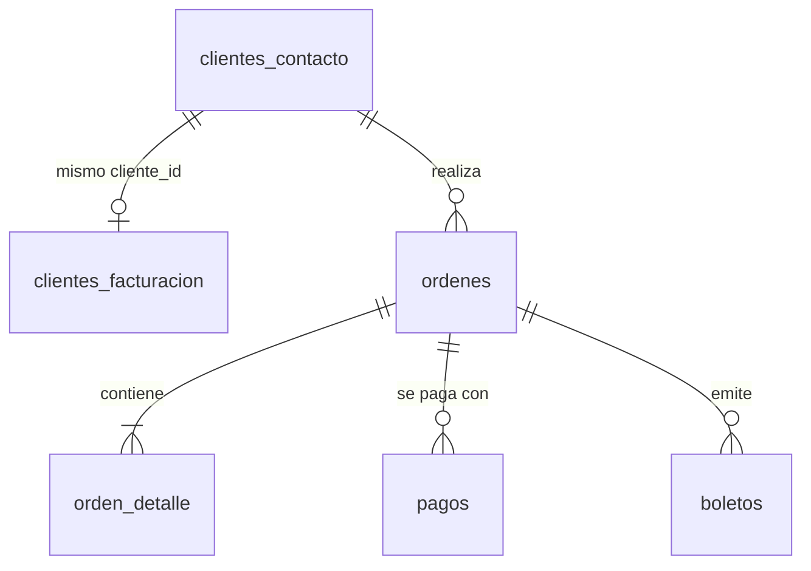
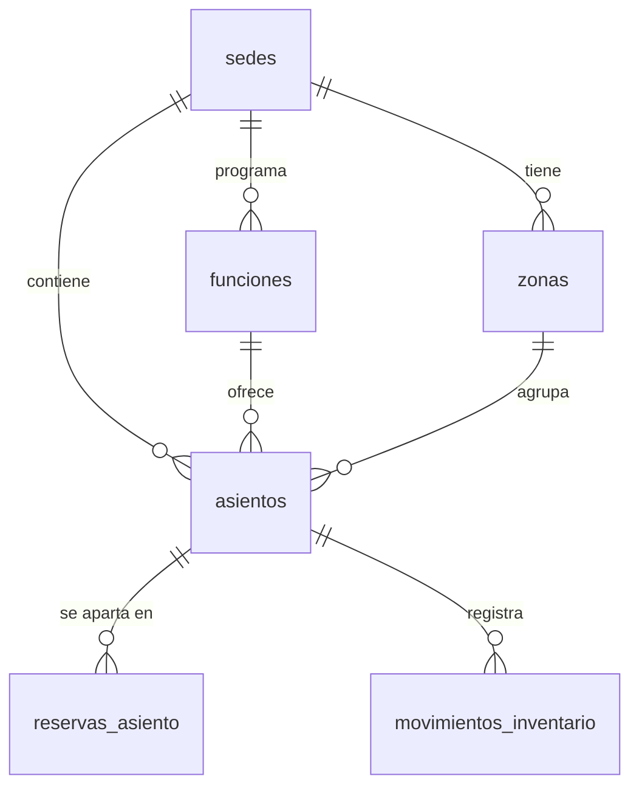

# Arquitectura de Boletera

Proyecto Final de Ingeniería de Datos (UAA 2026).

Plataforma de venta de boletos para eventos que usa MySQL, PostgreSQL y MongoDB de forma integrada sobre tres computadoras físicas conectadas por red local. Las bases no se comunican entre sí: la API es la única que las coordina.

## 1. Distribución de servicios

Las IPs son de ejemplo hasta confirmar las reales (ver `inventario.md`).

| PC | Servicios |
|---|---|
| PC1 | MySQL nodo 1, Mongo config 1, Mongo shardA nodo 1, Mongo shardB nodo 1, Prometheus, Grafana, API, exporters |
| PC2 | PostgreSQL primario, MySQL nodo 2, Mongo config 2, Mongo shardA nodo 2, Mongo shardB nodo 2, mongos, exporters |
| PC3 | PostgreSQL réplica, MySQL nodo 3, Mongo config 3, Mongo shardA nodo 3, Mongo shardB nodo 3, exporters |

## 2. MySQL

### 2.1 Qué guarda y por qué MySQL

Clientes, órdenes, detalle de orden, pagos y boletos. Son datos muy estructurados y transaccionales (hay dinero de por medio), con relaciones entre tablas.

### 2.2 Esquema

Base `boletera`, seis tablas InnoDB y una vista. El script completo está en `mysql/init/01_schema.sql`.

| Tabla | Descripción |
|---|---|
| `clientes_contacto` | Fragmento 1 del cliente: nombre, apellidos, correo, teléfono, ciudad. |
| `clientes_facturacion` | Fragmento 2 del cliente: RFC, razón social, dirección fiscal, método de pago preferido. |
| `ordenes` | Una orden por compra, con estado (pendiente, pagada, cancelada, expirada). |
| `orden_detalle` | Un renglón por asiento incluido en la orden. |
| `pagos` | Intentos de pago de cada orden. |
| `boletos` | Boletos emitidos, con código QR único. |
| `clientes_completo` (vista) | Reconstruye el cliente uniendo sus dos fragmentos. |

Las columnas `evento_id` (MongoDB), `funcion_id`, `sede_id` y `asiento_id` (PostgreSQL) son **referencias lógicas** la API se encargará de validar que existan y gestionar las llaves foráneas.

### 2.3 Fragmentación vertical

La entidad **cliente** se divide por columnas en dos tablas que comparten la clave `cliente_id`:

- `clientes_contacto` guarda lo que se consulta en casi cada operación.
- `clientes_facturacion` guarda los datos fiscales, que son sensibles y casi nunca se necesitan.

Justificación:

1. **Privacidad.** Se puede dar a un servicio permiso de lectura sobre el contacto sin exponer los datos fiscales. Se comprobó con el usuario `contacto_ro`: lee `clientes_contacto` y recibe `SELECT command denied` al consultar `clientes_facturacion`.
2. **Filas más pequeñas** en la tabla que más se lee, lo que mejora el uso de caché e índices.
3. **La entidad completa no se pierde.** La vista `clientes_completo` la reconstruye con un `LEFT JOIN` por `cliente_id`.

Los dos fragmentos están en el mismo grupo de replicación. Separarlos en servidores distintos haría perder las llaves foráneas y la transacción única, y duplicaría la replicación; el diagrama del profesor también los muestra como tablas del mismo MySQL.

### 2.4 Replicación

MySQL Group Replication con 3 nodos (uno por PC) en modo de primario único. Detalle de configuración en `mysql/conf/` y en el procedimiento de instalación (pendiente, día 3).

Group Replication exige clave primaria en toda tabla InnoDB: las seis la tienen.

### 2.5 Usuarios

| Usuario | Permisos | Para qué |
|---|---|---|
| `boletera_api` | SELECT, INSERT, UPDATE, DELETE sobre `boletera.*` | La API. |
| `contacto_ro` | SELECT sobre `boletera.clientes_contacto` | Demostrar el valor de la fragmentación vertical. |
| `exporter` | PROCESS, REPLICATION CLIENT, SELECT sobre `performance_schema` | Métricas para Prometheus. |
| `repl` | REPLICATION SLAVE y permisos de Group Replication | Recuperación distribuida entre nodos. |

Se crean el día 3, ya con el grupo formado. Las contraseñas van en `.env`, nunca en el repositorio.

## 3. PostgreSQL

### 3.1 Qué guarda y por qué PostgreSQL

Sedes, zonas, funciones, asientos, reservas y movimientos de inventario: el inventario de lugares. Es la parte del sistema con más competencia, porque en una preventa cientos de compradores intentan apartar los mismos asientos al mismo tiempo.

PostgreSQL da el control de concurrencia que esto necesita. La reserva es una sola sentencia, `UPDATE ... WHERE estado = 'libre' RETURNING`: si dos compras piden el mismo asiento, la segunda espera a que termine la primera y, al volver a evaluar la condición, ya no lo encuentra libre. Además tiene particionado declarativo para la fragmentación horizontal y Streaming Replication.

### 3.2 Esquema

Base `boletera`, seis tablas. El script completo está en `postgres/init/01_schema.sql`.

| Tabla | Descripción |
|---|---|
| `sedes` | Las 4 sedes: Aguascalientes, Ciudad de México, Guadalajara y Monterrey. |
| `zonas` | 10 por sede, con nombre y precio base. |
| `funciones` | 10 por sede. Cada una es una fecha de un evento en una sede. |
| `asientos` | 1,000 por función, con estado `libre`, `reservado` o `vendido`. **Particionada por sede.** |
| `reservas_asiento` | Asientos apartados mientras se cobra; vencen a los 10 minutos. **Particionada por sede.** |
| `movimientos_inventario` | Bitácora de cada cambio de estado de un asiento: `reserva`, `venta` o `liberacion`. |

La llave de un asiento es `(sede_id, asiento_id)`, con `asiento_id` del 1 al 10,000 dentro de cada sede. MySQL guarda esa misma pareja en `orden_detalle` y `boletos`.

`funciones.evento_id` (MongoDB) y `reservas_asiento.orden_id` (MySQL) son **referencias lógicas**: no tienen llave foránea y la API valida que existan.

Estados de una reserva:

| Estado | Significado |
|---|---|
| `activa` | Asiento apartado, esperando el pago. |
| `confirmada` | Se pagó y el asiento quedó `vendido`. |
| `expirada` | No se pagó en 10 minutos; el asiento volvió a `libre`. |
| `cancelada` | Se rechazó el pago; el asiento volvió a `libre`. |

_Pendiente: fragmentación horizontal con su evidencia, zonas, replicación y usuarios._

## 4. MongoDB

_Pendiente: colecciones, shard keys y justificación._
