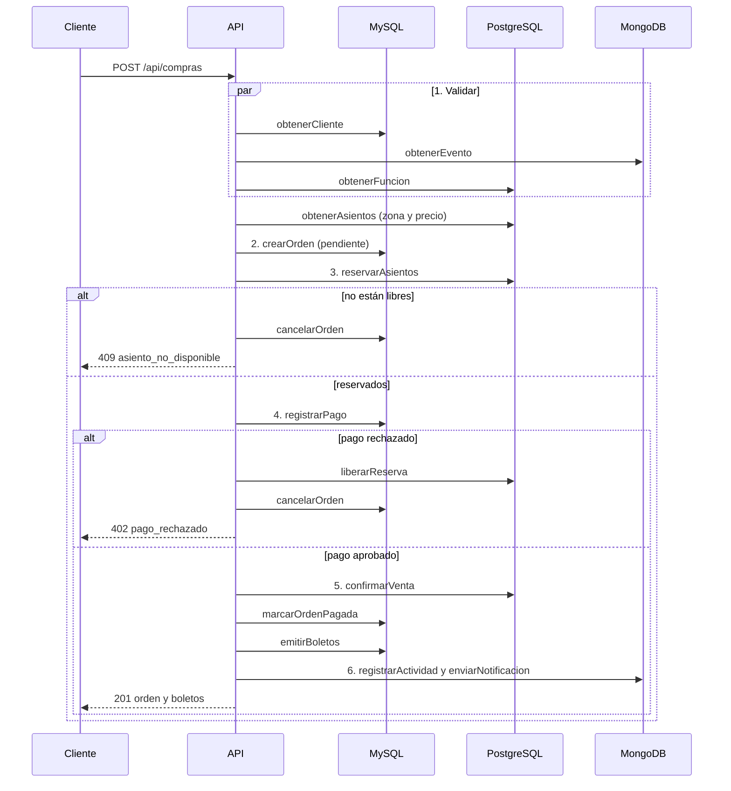

# Cómo funciona una compra

`POST /api/compras` toca los tres motores y no existe una transacción que los cubra a todos. Por eso la compra se hace en pasos, y si uno falla se deshacen los anteriores con una operación contraria (una *compensación*). El código está en `api/src/compras.js`.

## Los pasos

| # | Qué hace | Motor | Si falla |
|---|---|---|---|
| 1 | Valida que existan el cliente, el evento y la función, y trae zona y precio de los asientos | MySQL, MongoDB, PostgreSQL | 404 si algo no existe, 400 si un asiento no es de esa función |
| 2 | Crea la orden en `pendiente` con su detalle | MySQL | 500. Aún no hay nada que deshacer |
| 3 | Reserva los asientos con un solo `UPDATE` atómico | PostgreSQL | 409 y se cancela la orden |
| 4 | Cobra (simulado) y guarda el pago | MySQL | 402: se liberan los asientos y se cancela la orden |
| 5 | Confirma: asientos `vendido`, orden `pagada` y boletos con QR | PostgreSQL, MySQL | Ver abajo |
| 6 | Guarda la actividad y la notificación | MongoDB | No hace fallar la compra, solo queda en el log |
| 7 | Responde 201 con la orden y los boletos | | |

## Diagrama

## Qué toca cada paso

| Paso | MySQL | PostgreSQL | MongoDB |
|---|---|---|---|
| 1 | lee `clientes_contacto` (y `clientes_facturacion` si `factura` es `true`) | lee `funciones`, `asientos` y `zonas` | lee `eventos` |
| 2 | inserta en `ordenes` y `orden_detalle` | | |
| 3 | | `asientos` pasan a `reservado`, inserta en `reservas_asiento` y `movimientos_inventario` | |
| 4 | inserta en `pagos` | | |
| 4 (402) | `ordenes` a `cancelada` | `asientos` vuelven a `libre`, la reserva queda `cancelada` | |
| 5 | `ordenes` a `pagada`, inserta en `boletos` | `asientos` a `vendido`, la reserva queda `confirmada` | |
| 6 | | | inserta en `actividad_usuarios` y `notificaciones` |

## Reintentos

Cada operación se reintenta hasta 3 veces, esperando un poco más cada vez (100 ms, 200 ms), pero solo si el error es pasajero: conexión caída o rechazada, tiempo de espera agotado o deadlock. Un error de lógica, como una columna inexistente o un dato inválido, falla a la primera.

El escaneo de boletos (`POST /api/accesos`) no se reintenta: si el boleto ya se marcó como usado y la respuesta se perdió, repetirlo diría que ya estaba usado.

## Qué pasa en los casos raros

- **Dos compras piden el mismo asiento a la vez.** PostgreSQL bloquea la fila: la segunda espera, ve que ya no está libre y recibe 409. Nunca se vende dos veces (lo comprueba `test/compra.integracion.test.js` con cinco compras simultáneas).
- **Una compensación falla.** Se escribe el error en el log y se sigue con la siguiente, para no ocultar el 409 o el 402 original. Si lo que falló fue `cancelarOrden`, la orden se queda `pendiente` sin asientos: el proceso de expiración parte de las reservas de PostgreSQL y no la ve.
- **La reserva venció mientras se cobraba.** `confirmarVenta` devuelve `false`: no se emiten boletos, se cancela la orden y la respuesta es 409.
- **`confirmarVenta` falla por un error.** No se deshace nada: la reserva sigue activa y el proceso de expiración la libera y marca la orden como `expirada`.
- **MongoDB está caído.** La compra sale igual; solo faltan la actividad y la notificación.
- **El pago.** Es simulado: un cliente con número múltiplo de 50 siempre recibe 402. La tabla `pagos` no tiene un estado de reembolso, así que en el caso de la reserva vencida el pago queda como `aprobado` aunque la orden esté cancelada.

## Límites conocidos

- Una orden puede quedar `pendiente` sin reserva si falla `cancelarOrden` tras un 409 o un 402, o si `crearOrden` se reintenta después de que MySQL sí guardó la primera. No hay un proceso que las limpie. Esto último pasó en el ensayo de failover: una orden duplicada, sin pagos, por cada 6,000 compras hechas mientras caía el primario. El asiento no se vende dos veces; solo queda esa orden.
- Si MySQL cae justo después de que PostgreSQL confirmó la venta (paso 5) y se agotan los reintentos, los asientos quedan `vendido` sin boletos. Resolverlo pediría un proceso que reconcilie las dos bases; no está hecho.
- Si cambia el primario de MySQL, las compras en curso esperan a que el grupo elija uno nuevo (unos 5 segundos) y siguen. Cómo se encuentra el primario y qué hacer si no aparece: `docs/procedimientos-falla.md`.
